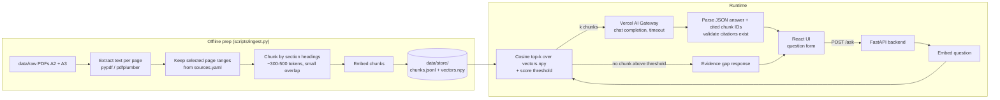

# Original plan

These are the initial design notes, written before implementation. The [README](README.md) describes the submitted system and the recorded results.

Guiding principle from the brief: the prototype is 20% of the grade, defence and next steps are 65%. So build the smallest clean thing that hits every requirement, and spend saved time on checks and reasoning.

## 1. Big picture



## 2. Repo layout

```
taylor-case/
  data/raw/            source PDFs (already there)
  data/sources.yaml    source metadata + page ranges used
  data/store/          generated: chunks.jsonl, vectors.npy, manifest.json (gitignored or committed, decide)
  backend/
    app/main.py        FastAPI: POST /ask, GET /health, GET /chunks/{id}
    app/retrieval.py   load store, cosine search, threshold
    app/llm.py         gateway client, timeout, error mapping
    app/prompts.py     system prompt + answer schema (prompts live in code, per brief)
    app/config.py      env vars: AI_GATEWAY_API_KEY, model names, top_k, threshold
  scripts/ingest.py    extract + chunk + embed + persist (rerunnable, idempotent)
  scripts/run_cases.py hits /ask with the two cases, saves outputs to eval/
  eval/cases.yaml      the two cases with expected behaviour
  eval/results/        saved outputs (json + a markdown table)
  frontend/            Vite + React, one page
  .env.example
  README.md
```

## 3. Data and ingestion

- **Sources:** A2 (DAFF guideline, pp. 17-22) and A3 (DAFF work instruction, section 8, pp. 18-24). One publisher, current July 2026 editions, CC BY 4.0. That's roughly within the 1,000-3,000 word guide, and I'd trim if it's over.
- **sources.yaml** holds the ID, title, publisher, URL, access date, version, doc ID, page ranges and licence. Ingestion reads from it, so the README table and the code can't drift.
- **Extraction:** `pypdf` page by page, keeping the page number. I'd eyeball the output against the PDF once, especially the conditional tables in A3 (the brief explicitly warns about tables and numbering). If the tables come out mangled, try `pdfplumber` for those pages.
- **Chunking:** split on the numbered section headings (8.1, 8.2, ...) first, then cap at about 400 tokens with about 50 tokens of overlap. Each chunk carries `chunk_id` (e.g. `A3-p19-c02`), `source_id`, `page`, `section` and `text`. Section-aware chunking is easy to defend: it keeps conditions and their outcomes together, and the citations stay meaningful.
- **Tables:** keep each table row together with its header, possibly as its own chunk. This is a known weak spot, so flag it as a limitation.

## 4. Embeddings and storage

- **Option A (my pick):** embeddings through the same Vercel AI Gateway key (e.g. an OpenAI small embedding model). It's one provider, the cost is cents, and there are no heavy local deps. Check the gateway's embedding model list first.
- **Option B:** local `sentence-transformers` (e.g. `bge-small-en`). It costs nothing, but adds torch to the install. It's a good alternative to mention.
- **Storage:** `chunks.jsonl` plus `vectors.npy` (normalized float32) plus `manifest.json` (embedding model, dimension, source hashes, created_at). Brute-force cosine with numpy. With fewer than 100 chunks, a vector DB is pure overhead, and that's an easy tradeoff to defend. Alternative: LanceDB or Chroma persisted locally, once the corpus grows.
- **Rebuild:** `python scripts/ingest.py --rebuild`. The backend refuses to start (or warns) if the manifest's embedding model doesn't match the config.

## 5. Retrieval

- Embed the question with the same model and take the top-k cosine (k = 4-5).
- **Score threshold:** if the best score is below about X (tuned on a few probe questions), return an evidence gap without calling the LLM. That's cheap, deterministic and easy to explain.
- **Second guard:** the LLM may also say "not in the sources" even when chunks pass the threshold. Two layers, retrieval and generation.
- Next-step ideas, not for v1: hybrid BM25 + vectors (domain terms like "fumigation" and "stowage" match lexically very well), a reranker, and query rewriting.

## 6. Generation

- **Client:** OpenAI-compatible client pointed at the Vercel AI Gateway (verify the base URL and model IDs in their docs). The model is a small, cheap one (a mini-class model), configurable via env.
- **Timeout:** 20-30 s, with one retry only on 429/5xx, and no retry on auth errors.
- **Prompt:** answer only from the numbered context chunks, cite chunk IDs for each claim, say clearly when the context doesn't answer, never claim to certify a vessel or replace an inspection, and keep Australian export context visible.
- **Structured output:** JSON with `answer`, `citations: [chunk_id]`, `status: answered | partial | not_in_sources`.
- **Validation:** drop citations to chunk IDs that weren't retrieved. If an "answered" result has zero valid citations, downgrade it to a gap or warning. That's a cheap hallucination check worth showing in the defence.
- Temperature 0 for repeatability.

## 7. API

- `POST /ask {question}` returns `{status, answer, citations:[{chunk_id, source_id, page, section, text, score}], retrieved:[...], model, latency_ms}`
- Errors map to `{status:"error", message}` with a clear message: timeout, auth, rate limit, upstream error. The key never appears in responses or logs.
- `GET /health` reports whether the store is loaded, plus the chunk count and model names.

## 8. Frontend

- One page: a question box, an Ask button and a loading state.
- **Answer card:** the text, with inline [A3-p19-c02] markers that are clickable.
- **Evidence panel:** the cited passages with source ID, page and section, plus a link to the original PDF URL.
- **Gap state:** a distinct box saying the selected documents don't cover this, with what the collection does cover (scope sentence).
- **Error state:** a red box with the backend message.
- Optional toggle to show all retrieved chunks and their scores. This is great for the defence, since it shows retrieval vs generation.

## 9. Verification (R6)

`eval/cases.yaml`:
1. **Answerable:** something clearly covered in A3 section 8, e.g. what an inspector checks in a hold or the conditions that lead to a fail. Expected: cites the right A3 chunk(s).
2. **Gap:** something plausible but absent, e.g. "What's the cleaning procedure for holds after carrying coal in Brazil?" or "What chemical concentration should be used for washing holds?" Expected: not_in_sources, no invented answer.

`scripts/run_cases.py` calls the API and saves the question, expected behaviour, retrieved chunk IDs and scores, the output, a verdict and a reason into `eval/results/`, plus a markdown table to paste into the README. Note the model and config used, and whether the cases influenced prompt or threshold tuning (honestly: probably yes for the threshold).

## 10. Cost estimate (target under 5 EUR)

- Embedding about 50 chunks of about 400 tokens is about 20k tokens, essentially 0.
- Each question is about 2.5k input and 300 output tokens on a mini model, a fraction of a cent.
- The whole prep plus the two cases plus a few dozen dev questions comes to well under 1 EUR. I'd state the assumptions in the README.

## 11. Decision notes to have ready (R8)

- **Flow:** section-aware chunks, numpy cosine top-k, a score threshold, then LLM JSON with validated citations.
- **Main tradeoff:** brute-force numpy vs a vector DB (simple and transparent vs scalable).
- **Alternative:** hybrid BM25 + vectors with a reranker, or local embeddings.
- **Limitation:** table extraction from A3, and the threshold being tuned on very few questions.
- **Next steps in priority order:**
  1. A small golden set (20-30 questions incl. gaps) with retrieval recall@k and citation faithfulness. It matters because it's the only way to change anything safely. Check: the numbers before and after each change.
  2. Hybrid retrieval plus a reranker. It matters because domain terms and short queries are a known weakness for embeddings. Check: recall@k on the golden set.
  3. Better table handling and partial/conflicting-answer UX. It matters because the conditional rows are where the actual decisions live. Check: a targeted subset of table questions.
- **Time spent and AI use:** be honest. AI wrote the scaffolding; I checked the extraction against the PDFs, read every prompt, and ran the cases myself.

## 12. Changed-constraint answers to prep

- **More documents:** move to LanceDB/pgvector, metadata filters (publisher, jurisdiction, version), dedupe, and versioned re-ingestion triggered by source hashes.
- **More users:** stateless backend, caching question embeddings and answers, rate limiting, observability (traces per request with retrieved IDs, latency, tokens).
- **Restricted or private sources:** keep everything local, use local embeddings, check whether the LLM provider has zero retention or self-host a model, and add per-user access filtering at retrieval time (never just in the prompt).
- **Pilot readiness:** a golden set plus user feedback buttons, per-stage latency and cost logging, failure triage (bad retrieval vs bad generation), and a doc update process that re-embeds only the changed sources.

## 13. Build order (about 3.5 h)

1. Ingestion plus a store sanity check (45 min)
2. Retrieval plus a CLI probe to tune k and the threshold (30 min)
3. LLM call, prompt, JSON and citation validation (45 min)
4. FastAPI endpoints and errors (20 min)
5. React page (40 min)
6. Two cases, saved results, and the README with sources, decisions and cost (40 min)
Then stop and rehearse the 10-minute walkthrough: 3 min demo, 3 min choices and limits, 4 min next steps.
